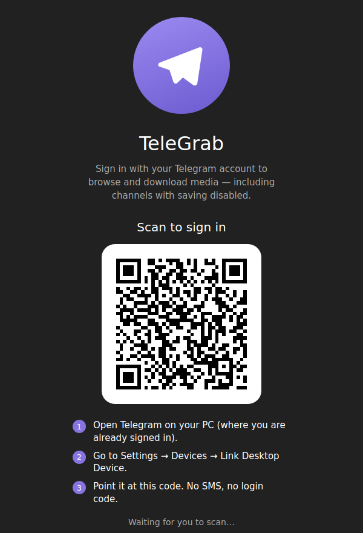

<div dir="rtl" align="right">

# TeleGrab

[English](README.md) · **العربية**

‏TeleGrab موقع صغير تشغّله بنفسك. تسجّل الدخول بحساب تيليجرام الخاص بك، وتفتح أي قناة أو مجموعة أنت عضو فيها، وتحمّل الصور والفيديوهات والملفات منها — **حتى القنوات التي فعّل صاحبها خيار "تقييد حفظ المحتوى"** (منع الحفظ ومنع إعادة التوجيه).

شكله وطريقة استعماله مثل تيليجرام ويب: قائمة المحادثات على اليسار، معرض الوسائط على اليمين، عارض بملء الشاشة، وتحميل بنقرة واحدة أو تحميل جماعي.

<p align="center"></p>

---

## ماذا يفعل المشروع؟

- **تسجيل الدخول برمز QR** — امسحه من تيليجرام على هاتفك أو حاسوبك. بدون رسالة SMS وبدون كتابة كود.
- **أو تسجيل الدخول برقم الهاتف** — يرسل لك تيليجرام كودًا، ثم كلمة مرور التحقق بخطوتين إن كانت مفعّلة.
- **قائمة محادثاتك** — الصور الشخصية، آخر رسالة، الوقت، عدد الرسائل غير المقروءة، وعلامة 🔒 على المحادثات التي يُمنع فيها الحفظ.
- **معرض وسائط لكل محادثة** — تبويبات: الوسائط / الصور / الفيديوهات / الملفات، مع بحث، وتجميع حسب الشهر، وتحميل المزيد تلقائيًا عند التمرير. تظهر هنا أيضًا المنشورات المدفوعة بالنجوم ⭐ مع معاينة مموّهة وسعرها.
- **عارض بملء الشاشة** — الصور (اضغط للتكبير)، الفيديو مع التقديم والتأخير، الصوت، وأسهم ‹ › أو أسهم لوحة المفاتيح للتنقل.
- **التحميل** — ملف واحد، أو كل ما تم تحميله، أو اختر عدة ملفات عبر زر **التحديد**. في كروم وإيدج، يُحفَظ التحميل الجماعي مباشرة في مجلد تختاره.
- **يعمل على الهاتف** — تتحول الواجهة إلى نسخة الهاتف عندما يكون عرض الشاشة أقل من 860 بكسل.
- **تسجيل الخروج** — يلغي الجلسة من جهة تيليجرام أيضًا.

## كيف يمكن تحميل المحتوى "المقيّد"؟

خيار "تقييد حفظ المحتوى" تفرضه **تطبيقات تيليجرام الرسمية** فقط: فهي تخفي زر الحفظ وتمنع إعادة التوجيه. لكن الملفات نفسها تصل إلى كل حساب مسموح له *برؤية* الرسالة.

‏TeleGrab يتصل بتيليجرام مباشرة (عبر بروتوكول MTProto باستخدام مكتبة [Telethon](https://github.com/LonamiWebs/Telethon))، فيحمّل الملف بنفس الطريقة التي يحمّله بها التطبيق لعرضه عليك، ثم يرسله إلى متصفحك.

> يمكنك تحميل ما يستطيع حسابك رؤيته فقط. المشروع لا يتجاوز القنوات الخاصة أو الحظر أو المحتوى المدفوع. احترم أصحاب المحتوى والقوانين في بلدك.

## المنشورات المدفوعة بالنجوم ⭐

المنشور الذي يُباع بالنجوم يصل من تيليجرام كسعر مع معاينة مموّهة فقط — والملف نفسه لا يُسلَّم إلى الحساب إلا بعد تسجيل الدفع في سجلات تيليجرام، لذلك لا يستطيع أي عميل تحميله قبل ذلك. لهذا يعرض TeleGrab هذه المنشورات بدل إخفائها: يظهر المربع المموّه مع شارة ⭐، ويشرح العارض السعر. وبعد أن تدفع فعليًا ثمن المنشور (من التطبيق الرسمي أو هاتفك) يتحول إلى عنصر عادي قابل للتحميل، ويُجلب ملفه كأي وسائط أخرى.

يفحص المعرض حالة الشراء عند تحميل الصفحة وقبل بدء أي تحميل. ولأن تيليجرام يستمر في إرسال المعاينة المموّهة حتى يُسأل صراحةً، فإذا بقي المنشور مقفلًا بعد الدفع مباشرةً، افتحه واضغط **I've paid — check again** («لقد دفعت — تحقّق مرة أخرى»).

التحميل الجماعي يتخطى المنشورات غير المدفوعة، ونقطة الوسائط تُرجع `402` لها بدل بدء نقل لا يمكن أن يكتمل.

---

## طريقة التشغيل

### ما تحتاجه

- **‏Python 3.10** أو أحدث
- **حساب تيليجرام**
- **‏`api_id` و `api_hash`** من تيليجرام (مجانًا، تأخذ دقيقتين — الخطوة 1)

### 1. احصل على مفاتيح API من تيليجرام

1. ادخل إلى <https://my.telegram.org> وسجّل الدخول برقم هاتفك (الكود يصلك داخل تطبيق تيليجرام).
2. اضغط على **API development tools**.
3. اكتب أي اسم للتطبيق واسمًا مختصرًا (مثلًا `TeleGrab` / `telegrab`)، واختر المنصة **Web**، ثم اضغط **Create application**.
4. انسخ **App api_id** (رقم) و **App api_hash** (32 حرفًا ورقمًا).

> حافظ على سرّية `api_hash`. لا تنشره ولا ترفعه إلى GitHub.

### 2. حمّل المشروع

<div dir="ltr" align="left">

```bash
git clone https://github.com/j1xxyboo/Telegrab.git
cd Telegrab
```

</div>

### 3. ثبّت المتطلبات

<div dir="ltr" align="left">

```bash
python3 -m venv .venv
source .venv/bin/activate          # Windows: .venv\Scripts\activate
pip install -r requirements.txt
```

</div>

### 4. أضف مفاتيحك

<div dir="ltr" align="left">

```bash
cp .env.example .env               # Windows: copy .env.example .env
```

</div>

افتح الملف `.env` واستبدل القيم المثالية بقيمك:

<div dir="ltr" align="left">

```ini
TELEGRAM_API_ID=12345678
TELEGRAM_API_HASH=your32characterhashgoeshere00000
```

</div>

### 5. شغّل المشروع

<div dir="ltr" align="left">

```bash
python run.py
```

</div>

ثم افتح **<http://127.0.0.1:8000>** في المتصفح.

### 6. سجّل الدخول

**برمز QR (الطريقة المفضّلة)**

1. افتح تيليجرام على هاتف أو حاسوب مسجّل الدخول فيه مسبقًا.
2. اذهب إلى **الإعدادات ← الأجهزة ← ربط جهاز سطح مكتب** (Settings → Devices → Link Desktop Device). على الهاتف: *مسح رمز QR*.
3. وجّه الكاميرا نحو الرمز في الصفحة. إذا كانت لديك كلمة مرور للتحقق بخطوتين، سيطلبها الموقع بعد ذلك.

**برقم الهاتف** — اضغط *Use phone number*، واكتب رقمك مع رمز الدولة (مثلًا `+213…`)، ثم اكتب الكود الذي يرسله تيليجرام. إذا كنت مسجّل الدخول على جهاز آخر، فالكود يصل **داخل تيليجرام** كرسالة من حساب "Telegram"، وليس عبر SMS.

### 7. حمّل الوسائط

اختر محادثة من اليسار ← اضغط على صورة أو فيديو لفتحه ← اضغط زر التحميل. لتحميل عدة ملفات مرة واحدة، اضغط زر ☑ في الأعلى، وحدّد ما تريد، ثم اضغط **Download**.

---

## التشغيل عبر Docker (اختياري)

<div dir="ltr" align="left">

```bash
docker build -t telegrab .
docker run -d --name telegrab -p 8000:8000 \
  --env-file .env \
  -v "$PWD/sessions:/app/sessions" \
  telegrab
```

</div>

مجلد `sessions` يبقيك مسجّل الدخول حتى بعد إعادة تشغيل الحاوية.

## الإعدادات

كل الإعدادات توضع في ملف `.env`. أول إعدادين فقط إجباريان.

| المتغير | القيمة الافتراضية | الوظيفة |
| --- | --- | --- |
| `TELEGRAM_API_ID` | — | رقم تطبيقك من my.telegram.org **(إجباري)** |
| `TELEGRAM_API_HASH` | — | الـ hash الخاص بتطبيقك من my.telegram.org **(إجباري)** |
| `TELE_HOST` | `127.0.0.1` | العنوان الذي يستمع عليه الخادم (`0.0.0.0` للسماح لأجهزة أخرى) |
| `TELE_PORT` | `8000` | المنفذ |
| `TELE_COOKIE_SECURE` | `0` | اجعله `1` إذا كان الموقع يعمل عبر HTTPS |
| `TELE_SESSIONS_DIR` | `./sessions` | مكان حفظ جلسات تسجيل الدخول |
| `TELE_CACHE_DIR` | `./cache` | ذاكرة مؤقتة للصور المصغّرة والصور الشخصية |
| `TELE_LOG_FILE` | `./logs/tegrab.log` | سجل الخادم |
| `TELE_SESSION_TTL` | `43200` | عدد ثواني عدم النشاط قبل إغلاق الجلسة |
| `TELE_DIALOG_LIMIT` | `500` | عدد المحادثات التي يتم تحميلها |
| `TELE_CHUNK_SIZE` | `524288` | حجم كل جزء أثناء التحميل (بالبايت) |

## المشاكل وحلولها

| المشكلة | الحل |
| --- | --- |
| الصفحة تقول إن مفاتيح API غير موجودة | ملف `.env` غير موجود أو ما زال فيه القيم المثالية. عدّله ثم أعد تشغيل `python run.py`. |
| كود الدخول لا يصل أبدًا | استعمل **رمز QR** بدلًا منه. إذا كنت مسجّل الدخول على جهاز آخر، فالكود يُرسَل *داخل تيليجرام* (افتح محادثة "Telegram"، وتحقق من المحادثات المؤرشفة). |
| `ApiIdInvalidError` | الـ `api_id` أو `api_hash` خاطئ — انسخهما من جديد من my.telegram.org. |
| رسالة "انتظر N ثانية" (flood wait) | تيليجرام يحدّ من سرعة طلباتك. انتظر ثم تابع بشكل أبطأ. |
| التحميل يتوقف أو "Network error" | أعد تشغيل الخادم وحدّث الصفحة بـ **Ctrl+Shift+R**. راجع الملف `logs/tegrab.log`. |
| تريد استعماله من هاتفك على نفس شبكة الواي فاي | اجعل `TELE_HOST=0.0.0.0`، أعد التشغيل، وافتح `http://<IP-حاسوبك>:8000`. |

لمعرفة سبب المشكلة، افتح `http://127.0.0.1:8000/api/diag` أو اقرأ الملف `logs/tegrab.log`.

## الأمان

- **مجلد `sessions/` هو حساب تيليجرام الخاص بك وهو مسجّل الدخول.** أي شخص يملك هذه الملفات يستطيع استعمال حسابك. لا تشاركها ولا ترفعها أبدًا (هي موجودة مسبقًا في `.gitignore`).
- افتراضيًا، يعمل TeleGrab على حاسوبك فقط (`127.0.0.1`). إذا نشرته على الإنترنت، استعمل HTTPS، وضع كلمة مرور أمامه (مثل basic auth عبر reverse proxy أو Cloudflare Access)، واجعل `TELE_COOKIE_SECURE=1`.
- **تسجيل الخروج** من التطبيق (قائمة ☰) يحذف الجلسة من تيليجرام ويحذف الملف.

## هيكل المشروع

<div dir="ltr" align="left">

```text
app/
  config.py        reads .env and settings
  tg.py            Telegram client (login, chats, media, downloads)
  qr.py            makes the QR code image
  main.py          web server and API routes
  static/          the website: index.html · style.css · app.js
run.py             start the server
tests/             automatic tests (python3 tests/test_smoke.py)
Dockerfile
.env.example       template for your keys
```

</div>

| الملف | الوظيفة |
| --- | --- |
| `app/config.py` | يقرأ ملف `.env` والإعدادات |
| `app/tg.py` | الاتصال بتيليجرام: الدخول، المحادثات، الوسائط، التحميل |
| `app/qr.py` | يصنع صورة رمز QR |
| `app/main.py` | خادم الويب ومسارات الـ API |
| `app/static/` | واجهة الموقع |
| `run.py` | تشغيل الخادم |
| `tests/` | الاختبارات التلقائية |

## الاختبارات

<div dir="ltr" align="left">

```bash
python3 tests/test_smoke.py
```

</div>

تعمل بدون إنترنت وبحساب تيليجرام وهمي، فلا تحتاج إلى أي مفاتيح.

للتفاصيل التقنية وقائمة مسارات الـ API، راجع [النسخة الإنجليزية](README.md#api-for-developers).

## الرفع إلى GitHub

لرفع المشروع إلى GitHub من داخل Codespace، راجع ملف **[PUSH.md](PUSH.md#العربية)**.

</div>
