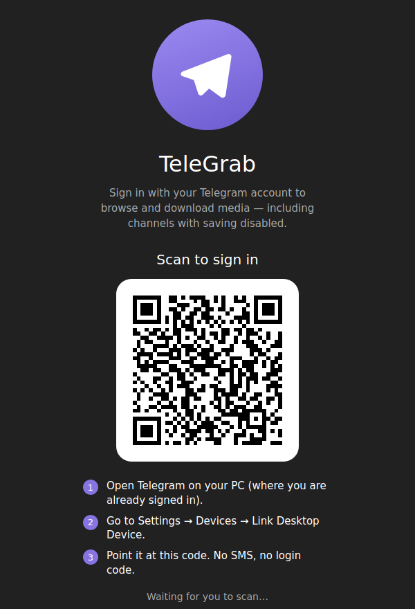

# TeleGrab

**English** · [العربية](README.ar.md)

TeleGrab is a small website you run yourself. You sign in with your own Telegram account, open any channel or group you are a member of, and download its photos, videos and files — **including channels where the owner turned on "Restrict saving content"** (no saving, no forwarding).

It looks and works like Telegram Web: chat list on the left, media gallery on the right, full-screen viewer, and one-click or bulk downloads.

<p align="center"></p>

---

## What it does

- **Sign in with QR code** — scan it from Telegram on your phone or PC. No SMS, no code to type.
- **Or sign in with phone number** — Telegram sends you a code, plus your two-step password if you have one.
- **Your chat list** — avatars, last message, time, unread counts, and a 🔒 on chats with saving disabled.
- **Media gallery per chat** — tabs for Media / Photos / Videos / Files, search, grouped by month, loads more as you scroll. Paid (Stars) posts appear here too, with a blurred preview and the ⭐ price.
- **Full-screen viewer** — photos (click to zoom), videos with seeking, audio, and ‹ › arrows / keyboard arrows.
- **Downloads** — one file, everything loaded, or pick several with **Select**. In Chrome/Edge, bulk downloads go straight into a folder you choose.
- **Works on phones** — the layout switches to a mobile view under 860 px wide.
- **Log out** — revokes the login on Telegram's side too.

## How downloading "restricted" media works

"Restrict saving content" is enforced by the **official Telegram apps**: they hide the save button and block forwarding. The files themselves are still sent to every account that is allowed to *see* the message.

TeleGrab talks to Telegram directly (the MTProto protocol, via the [Telethon](https://github.com/LonamiWebs/Telethon) library). It downloads the file the same way the app does for showing it, and passes it to your browser.

> You can only download what your account can already see. TeleGrab doesn't get around private channels, bans or paid content. Respect the content owners and the law where you live.

## Paid (Stars) posts

A post sold for Stars arrives from Telegram as a price plus a blurred preview — the file itself is only handed to an account after the payment is on its ledger, so no client can download it before then. TeleGrab therefore lists these posts instead of hiding them: the gallery shows the blurred tile with a ⭐ badge, and the viewer explains the price. Once you have actually paid for the post (in the official app or on your phone), it turns into a normal, downloadable item — the paid file is fetched exactly like any other media.

The gallery checks for a purchase when it loads a page and before it starts a download. Telegram keeps reporting the blurred preview until you ask specifically, so if a post stays locked right after you paid, open it and press **I've paid — check again**.

Bulk download skips posts you have not paid for, and the media endpoint answers `402` for them rather than starting a transfer that cannot finish.

---

## How to make it work

### What you need

- **Python 3.10 or newer**
- A **Telegram account**
- An **`api_id` and `api_hash`** from Telegram (free, takes 2 minutes — step 1)

### 1. Get your Telegram API keys

1. Go to <https://my.telegram.org> and log in with your phone number (the code arrives inside the Telegram app).
2. Click **API development tools**.
3. Fill in any app name and short name (e.g. `TeleGrab` / `telegrab`), platform **Web**, then **Create application**.
4. Copy the **App api_id** (a number) and **App api_hash** (32 letters/numbers).

> Keep the `api_hash` private. Don't post it or commit it to GitHub.

### 2. Download the project

```bash
git clone https://github.com/j1xxyboo/Telegrab.git
cd Telegrab
```

### 3. Install

```bash
python3 -m venv .venv
source .venv/bin/activate          # Windows: .venv\Scripts\activate
pip install -r requirements.txt
```

### 4. Add your keys

```bash
cp .env.example .env               # Windows: copy .env.example .env
```

Open `.env` and replace the example values with yours:

```ini
TELEGRAM_API_ID=12345678
TELEGRAM_API_HASH=your32characterhashgoeshere00000
```

### 5. Start it

```bash
python run.py
```

Then open **<http://127.0.0.1:8000>** in your browser.

### 6. Sign in

**QR code (recommended)**

1. Open Telegram on a phone or PC where you're already logged in.
2. Go to **Settings → Devices → Link Desktop Device** (on a phone: *Scan QR*).
3. Point it at the code on the page. If you have a two-step password, the site asks for it next.

**Phone number** — click *Use phone number*, enter it with the country code (e.g. `+213…`), then type the code Telegram sends. If you're logged in somewhere else, the code shows up **inside Telegram** as a message from "Telegram", not by SMS.

### 7. Download

Pick a chat on the left → click a photo or video to open it → press the download button. To grab many at once, press the ☑ button at the top, tick the ones you want, and press **Download**.

---

## Run with Docker (optional)

```bash
docker build -t telegrab .
docker run -d --name telegrab -p 8000:8000 \
  --env-file .env \
  -v "$PWD/sessions:/app/sessions" \
  telegrab
```

The `sessions` volume keeps you logged in when the container restarts.

## Settings

All settings go in `.env`. Only the first two are required.

| Variable | Default | What it does |
| --- | --- | --- |
| `TELEGRAM_API_ID` | — | Your app id from my.telegram.org **(required)** |
| `TELEGRAM_API_HASH` | — | Your app hash from my.telegram.org **(required)** |
| `TELE_HOST` | `127.0.0.1` | Address to listen on (`0.0.0.0` to allow other devices) |
| `TELE_PORT` | `8000` | Port |
| `TELE_COOKIE_SECURE` | `0` | Set to `1` if you serve it over HTTPS |
| `TELE_SESSIONS_DIR` | `./sessions` | Where login sessions are stored |
| `TELE_CACHE_DIR` | `./cache` | Thumbnail and avatar cache |
| `TELE_LOG_FILE` | `./logs/tegrab.log` | Server log |
| `TELE_SESSION_TTL` | `43200` | Seconds of inactivity before a session is closed |
| `TELE_DIALOG_LIMIT` | `500` | How many chats to load |
| `TELE_CHUNK_SIZE` | `524288` | Download chunk size in bytes |

## Problems and fixes

| Problem | Fix |
| --- | --- |
| Page says the API keys are missing | `.env` is missing or still has the example values. Edit it and restart `python run.py`. |
| The login code never arrives | Use the **QR code** instead. If you're logged in on another device, the code is sent *inside Telegram* (check the "Telegram" chat, including Archived). |
| `ApiIdInvalidError` | The `api_id` / `api_hash` pair is wrong — copy both again from my.telegram.org. |
| "Wait N seconds" / flood wait | Telegram is rate-limiting you. Wait, then continue more slowly. |
| Download stops or "Network error" | Restart the server and reload the page with **Ctrl+Shift+R**. Check `logs/tegrab.log`. |
| Want to use it from your phone on the same Wi-Fi | Set `TELE_HOST=0.0.0.0`, restart, open `http://<your-PC-IP>:8000`. |

To see what's going wrong, open `http://127.0.0.1:8000/api/diag` or read `logs/tegrab.log`.

## Security

- The **`sessions/` folder is your logged-in Telegram account.** Anyone with those files can use your account. Never share or upload them (they're already in `.gitignore`).
- By default TeleGrab only listens on your own computer (`127.0.0.1`). If you put it on the internet, use HTTPS, add a password in front (reverse proxy basic auth, Cloudflare Access, etc.) and set `TELE_COOKIE_SECURE=1`.
- **Log out** in the app (☰ menu) removes the session from Telegram and deletes the file.

## Project layout

```text
app/
  config.py        reads .env and settings
  tg.py            Telegram client (login, chats, media, downloads)
  qr.py            makes the QR code image
  main.py          web server and API routes
  static/          the website: index.html · style.css · app.js
run.py             start the server
tests/             automatic tests (python3 tests/test_smoke.py)
Dockerfile
.env.example       template for your keys
```

## API (for developers)

All endpoints except `/api/status` and `/health` need the login cookie.

| Method | Path | Purpose |
| --- | --- | --- |
| `GET` | `/api/status` | Are keys set, who is logged in |
| `POST` / `GET` | `/api/auth/qr` | Start / poll QR login |
| `POST` | `/api/auth/start` · `/code` · `/password` · `/resend` | Phone login steps |
| `POST` | `/api/auth/logout` | Log out and revoke the session |
| `GET` | `/api/dialogs` | Chat list |
| `GET` | `/api/dialogs/{peer}/messages` | Media in a chat (`kind`, `limit`, `offset_id`, `search`) |
| `GET` | `/api/media/{peer}/{id}` | The file (`?dl=0` to show in the browser; supports `Range`) |
| `GET` | `/api/thumb/{peer}/{id}` · `/api/avatar/{peer}` | Thumbnails and avatars |
| `GET` | `/api/diag` · `/api/diag/log` | Connection check and log tail |

## Tests

```bash
python3 tests/test_smoke.py
```

Runs offline with a fake Telegram account, so no keys are needed.

## Uploading to GitHub

To push this project to GitHub from a Codespace, see **[PUSH.md](PUSH.md)**.
